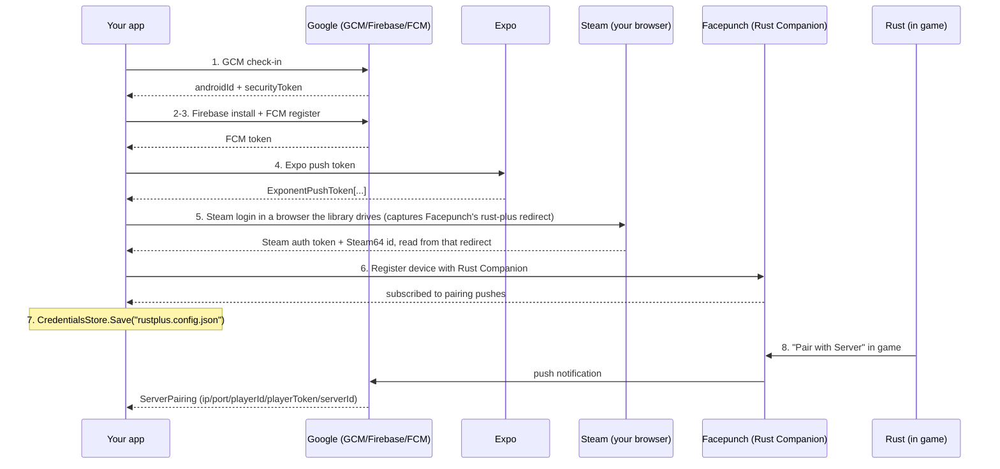

# Credentials

To use Rust+ you need credentials. There are two kinds:

- **FCM credentials** — identify your "device" to Google Firebase Cloud Messaging so you can
  receive Rust+ push notifications (used by `RustPlusFcm`).
- **Server pairing values** — `ip`, `port`, `playerId`, `playerToken` for a specific server, sent
  to you as a push notification when you choose *Pair with Server* in game (used by `RustPlus`).

The `RustPlusApi.Fcm.Registration` package acquires both natively, replacing the
`rustplus.js` Node CLI.

The quickest route is the console sample, `RustPlus.Register.ConsoleApp`: run it once, sign in to
Steam in the browser window it opens, and pair in game. Everything below documents the registration
chain it drives, which you can also call from your own code.

## The flow



`FcmRegistration` orchestrates the whole chain:

```csharp
using RustPlusApi.Fcm.Registration;

var registration = new FcmRegistration();

// Steps 1–4: GCM check-in → Firebase install → FCM register → Expo token.
var credentials = await registration.AcquireCredentialsAsync();

// Steps 5–6: interactive Steam login (opens a browser window the library drives) + Rust Companion device registration.
var steamLogin = await registration.RegisterWithRustPlusAsync(
    credentials,
    onLoginUrl: url => Console.WriteLine($"Steam login address: {url}"));

// Step 7: persist for later runs.
CredentialsStore.Save("rustplus.config.json", credentials);

// Step 8: pair in game; one await yields the RustPlus constructor args.
using var listener = new PairingListener(credentials);
ServerPairing pairing = await listener.WaitForServerPairingAsync();
// new RustPlus(new CompanionConnection(pairing.ServerId, steamLogin.Token, pairing.PlayerId, pairing.PlayerToken))
// or, where the server still accepts direct connections:
// new RustPlus(new DirectConnection(pairing.Ip, pairing.Port, pairing.PlayerId, pairing.PlayerToken))
```

| Step | Component | Result |
| --- | --- | --- |
| 1 | `AndroidFcmRegister.CheckInAsync` | Android id + security token |
| 2 | `AndroidFcmRegister.InstallAsync` | Firebase installation token |
| 3 | `AndroidFcmRegister.RegisterFcmAsync` | FCM token |
| 4 | `ExpoPushClient.GetTokenAsync` | Expo push token |
| 5 | `SteamLoginService.LoginAsync` | Steam auth token + Steam64 id (`SteamLoginResult`) |
| 6 | `RustCompanionClient.RegisterAsync` | device subscribed to pairing pushes |
| 7 | `CredentialsStore.Save` | `rustplus.config.json` |
| 8 | `PairingListener` | `ServerPairing` (ip/port/playerId/playerToken/serverId) |

Steps 1–7 run once. Step 8 happens every time you pair a new server in game.

The Steam auth token from step 5 (`SteamLoginResult.Token`) is also the `AuthToken` that the
[companion socket](rustplus-client.md#companion-socket) authenticates with, alongside the pairing's
`ServerId`. `CredentialsStore` does not save it — keep it yourself if you connect that way.

## How the Steam login works

`SteamLoginService` opens a browser window of its own and drives it over the Chrome DevTools
Protocol (CDP). It does not listen for a redirect: Facepunch now ends the login by redirecting to
the Rust+ app's own address, `rust-plus://rust-auth-session?…`, which no ordinary web page can
receive, so the library captures that redirect inside the browser instead.

> [!NOTE]
> Before Facepunch's October 2026 change, this section described a loopback `returnUrl` and an
> `HttpListener`. Facepunch no longer redirects there, and that route is gone from the library.

1. **Find a browser.** Edge on Windows first, otherwise Chrome, Brave or Chromium, including
   Flatpak. Snap browsers are detected and skipped (so is a launcher script that starts one, such as
   Ubuntu's apt `chromium-browser`), and relative `PATH` entries are ignored.
   `SteamLoginOptions.BrowserPath` (an absolute path) overrides the search.
2. **Start it with a fresh temporary profile** and a DevTools debugging port the browser picks
   itself (it reports the port in a `DevToolsActivePort` file in the profile). You sign in to Steam
   in that window, so you are not signed in there already. The profile lives in
   `<temp>/RustPlusApi.SteamLogin/<random>` on Windows and macOS,
   `$XDG_CACHE_HOME/RustPlusApi.SteamLogin/<random>` (or `~/.cache/…`) on Linux, and
   `~/.var/app/<app-id>/cache/RustPlusApi.SteamLogin/<random>` for a Flatpak browser.
3. **Open the login page**, `https://companion-rust.facepunch.com/login?returnUrl=%2Fapp%3FreturnUrl%3Drust-plus%3A%2F%2Frust-auth-session`,
   and watch only Facepunch's `/app` and `/login-failed` pages. Nothing is injected into the page
   and nothing is clicked.
4. **Capture the redirect.** When Facepunch answers with `rust-plus://rust-auth-session?…`, the
   library reads the Steam id and token from it and never follows it, so the official Rust+ desktop
   app is not launched.
5. **Clean up.** The browser is closed and the profile deleted after every login. If deletion
   fails, the login still succeeds and the next login sweeps the leftover; a leftover with no
   lock is swept after 5 minutes. A process killed hard (debugger stop, `kill`) can leave the
   browser window open for you to close.

`onLoginUrl` is called with the login URL first. The Rust+ auth token lives 14 days.

### Windows

Facepunch appears to block Windows browsers deliberately: it answers "Login Failed" to them. On
Windows the library therefore reports a non-Windows browser to Facepunch, on its `/app` steps only.
This is a workaround for behaviour Facepunch controls, so it may break again.

### When there is no browser to drive

With Firefox only, only Snap browsers, no display (containers, SSH), or a browser that fails to
start, the login falls back to asking you for the address by hand. Set
`FcmRegistration.SteamLoginOptions.ReadPastedAddress`:

```csharp
var registration = new FcmRegistration
{
    SteamLoginOptions = new SteamLoginOptions
    {
        ReadPastedAddress = async (reason, ct) =>
        {
            Console.WriteLine(reason);                           // why the browser route was not used
            Console.WriteLine(SteamLoginService.PasteInstructions);
            Console.Write("Paste the address here: ");
            return await ReadLineAsync(ct) ?? "";                // your own cancellable line reader
        },
    },
};
```

The callback returns the `rust-plus://rust-auth-session?…` address the user copies from their own
browser's developer tools (`PasteInstructions` says how). Surrounding whitespace, quotes and a
leading `Location:` label are tolerated. Without the callback, `LoginAsync` throws
`InvalidOperationException` with the message `{reason} {PasteInstructions} Login address: {loginUrl}`.

### Failures

- **"The browser window was closed before the Steam login finished."** You closed the window early.
- **"Facepunch refused the Steam login at its last step (it answered with a page instead of the
  sign-in redirect). Facepunch may have changed its login."** Facepunch answered its final `/app`
  step with its "Login Failed" page instead of the redirect; the window closes at once, so you may
  only glimpse it. On Windows that is usually the block above. If the message adds "although the
  browser was reported as non-Windows", the workaround no longer gets past Facepunch's check.
- **"Facepunch showed its Login Failed page (reason: …). Start the login again."** Facepunch sent
  the browser to its Login Failed page. With `reason: cancelled` the login did not complete; start
  it again from the beginning.
- **"Facepunch answered HTTP … at its last step."** Facepunch's final `/app` step failed with that
  HTTP status; try again later.
- **"The browser rejected a debugging command during the Steam login."** The browser refused a CDP
  command; try another browser, or set `SteamLoginOptions.BrowserPath`.

### Security

While the login runs, the browser's DevTools debugging port listens on `127.0.0.1` without
authentication, so any local process could attach to the login window during that time. This is an
accepted local risk, as it was in the pre-September-2026 version of this login. The browser picks
the port itself as it starts, and the library reads it from the `DevToolsActivePort` file the
browser writes into the private profile directory, so no other process can take the port before the
browser binds it.

`port` (`SteamLoginService(port)`, `FcmRegistration(steamLoginPort: …)`) is kept for source
compatibility and is unused.

## Upstream fragility

Every network step depends on live Google, Expo and Facepunch services, whose endpoints and
constants drift when those apps change. The flow is ported from rustplus.js /
`@liamcottle/push-receiver`; if registration breaks, re-check `RegistrationConstants` against
those upstream sources. The offline test suite covers the deterministic parts; the live flow is
validated by running the `RustPlus.Register.ConsoleApp` sample end to end.

The Steam login is the most exposed of these. Facepunch has already changed it once: it stopped
honouring ordinary `returnUrl` redirects and now ends the login with a `rust-plus://` redirect meant
for its own app, and it appears to block Windows browsers. `SteamLoginService` depends on that
redirect and on the Windows workaround staying valid. If Facepunch changes either again, expect
"Facepunch refused the Steam login at its last step…".

## Loading credentials back

```csharp
var credentials = CredentialsStore.Load("rustplus.config.json");
var listener = new RustPlusFcm(credentials);
```

The legacy rustplus.js `rustplus.config.json` format is also accepted by the FCM sample's loader.

> [!WARNING]
> `rustplus.config.json` contains long-lived push credentials (the GCM security token and
> FCM/Expo tokens) in plain JSON — anyone who can read the file can receive your pairing
> notifications. Treat it like a password file: keep it out of version control and shared
> directories. On .NET 10+ on Linux/macOS, `CredentialsStore.Save` restricts it to owner
> read/write; on other targets, restrict permissions yourself.
